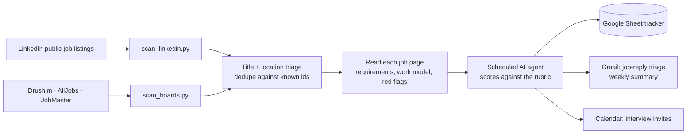

# Job Radar

An automated job-search pipeline I built for my own search in Israel. A scheduled AI agent
scans job boards every day, removes duplicates, scores every opening against a written rubric,
and keeps a Google Sheet up to date. A morning of manual searching became a ranked list that
is ready when I open it.

## How it works



| Step | What happens |
|---|---|
| **Scan** | Two Python scanners pull 300–400 new Israeli openings every 3 days. LinkedIn is read to the end of the results for broad terms (a 50-result cap missed about half the jobs). Drushim exposes its list as embedded JSON; AllJobs and JobMaster are parsed from HTML. |
| **Triage** | Regex filters drop titles and locations that can never fit, and every id already seen is skipped, so each job is read once. |
| **Read** | Each remaining job page is fetched (3 at a time, with back-off on HTTP 429). The scanners pull out requirements, years of experience, work model, and flags such as *degree required*, *on-call* or *office only*. |
| **Score** | A scheduled agent (Claude) scores each job 0–100 against a written rubric and quotes the job-page line behind every deduction, so a score can be checked. See [`scoring-rubric.example.md`](scoring-rubric.example.md). |
| **Track** | Results go to a Google Sheet: new jobs, application status, follow-ups, a contacts tab, and a "scanned" tab used for deduplication. The agent also re-checks open rows and marks jobs that have closed. LinkedIn often closes a job by quietly removing the Apply button. |
| **Prepare** | For top-scored jobs the agent prepares an application kit ahead of time, so nothing waits on me. |

## What I learned building it

- **Calibrate on outcomes, not intuition.** I first wrote the rubric by gut feel. I then rebuilt it from my own history (about 95 applications), which showed which role types actually produced interviews.
- **Unattended runs need different rules.** A scheduled agent that ends its turn while a background scan is still running stops the run. The prompt now requires foreground waits with a timeout.
- **Verify before writing.** Every job is checked on its live page before it reaches the sheet. Aggregator listings often stay up after the employer has closed the role.

## Run the scanners

Python 3, standard library only.

```bash
python3 scan_linkedin.py 259200 known_ids.txt > jobs.jsonl 2> scan.log   # last 3 days
python3 scan_boards.py known_ids.txt > boards.jsonl 2> boards.log
```

Each prints one JSON object per job and a `# STATS` line to stderr. The search terms and
filters at the top of each file are mine (program/project/product roles in central Israel);
change them to fit your own search.

Both scanners read public pages only, with no login. They are rate-limited (one request
every 1–1.5 s per thread, 3 threads) and back off when a site asks them to slow down.
